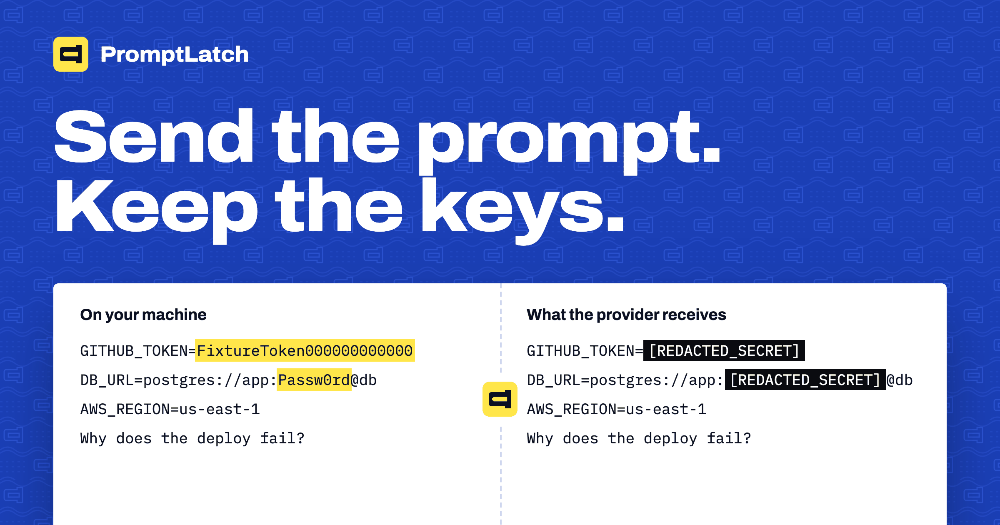
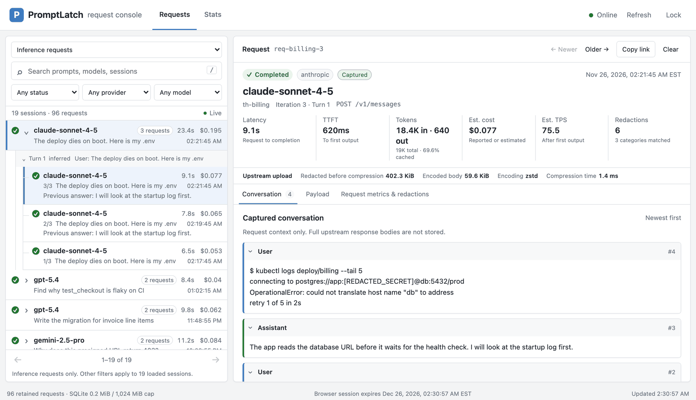

# PromptLatch

[](https://github.com/bvolpato/promptlatch/actions/workflows/ci.yml)
[](https://pypi.org/project/promptlatch/)
[](https://github.com/bvolpato/promptlatch/blob/main/pyproject.toml)
[](https://github.com/bvolpato/promptlatch/blob/main/LICENSE)

**Send the prompt. Keep the keys.**

Coding agents read your `.env`, your logs, and your configs, then send them to a model. PromptLatch runs on your machine and redacts the credentials before the request leaves.

[](https://bvolpato.github.io/promptlatch/)

- **Use it as a proxy** for Claude Code, Codex, Antigravity CLI, OpenCode, or any client with a custom base URL.
- **Use it as a Python library** to redact text, messages, or payloads before an SDK call.
- **It stays local.** Rules are deterministic, with no model calls and no telemetry. The proxy downloads a public price list once a day for cost estimates and sends no data about you. To turn this off, set `observability.pricing_enabled: false`.

[Try the live demo](https://bvolpato.github.io/promptlatch/) or start below.

## Quick start

### Coding agents

Install PromptLatch with [uv](https://docs.astral.sh/uv/getting-started/installation/), which also supplies Python, and start the proxy:

```bash
uv tool install promptlatch
curl -fsSL -o agents.yaml \
  https://raw.githubusercontent.com/bvolpato/promptlatch/main/examples/promptlatch-agents.config.yaml
promptlatch serve --config agents.yaml
```

In another terminal, use the wrapper for your agent:

| Instead of | Run |
| --- | --- |
| `claude` | `claude-latch` |
| `codex` | `codex-latch` |
| `agy` | `agy-latch` |

`claude-latch` and `codex-latch` keep your login. `agy-latch` needs `GEMINI_API_KEY`, because Antigravity account sign-in does not use the proxy. The wrappers do not edit your agent's config files. If the proxy is down or redaction is off, they stop instead of sending unredacted prompts. For OpenCode, OpenRouter, and manual setup, see the [agent guide](https://github.com/bvolpato/promptlatch/blob/main/docs/coding-agents.md).

### Any API client

Set an upstream provider, keep its key in your shell, and start the proxy:

```bash
promptlatch init --target-base-url https://api.openai.com/v1
export OPENAI_API_KEY="<openai-upstream-key>"
promptlatch serve
```

Then point your client at `http://127.0.0.1:8000/v1`:

```bash
curl http://127.0.0.1:8000/v1/responses \
  -H "Content-Type: application/json" \
  -d '{"model":"gpt-6-sol","input":"Read my .env: GITHUB_TOKEN=example-value-123456"}'
```

The provider receives `GITHUB_TOKEN=[REDACTED_SECRET]`. OpenAI, Anthropic, Gemini, OpenRouter, and local Ollama or vLLM endpoints work. See [providers and routes](https://github.com/bvolpato/promptlatch/blob/main/docs/providers.md).

### Python

No proxy needed:

```bash
uv add promptlatch
```

```python
from openai import OpenAI
from promptlatch import redact_params

client = OpenAI()
response = client.responses.create(
    **redact_params(
        model="gpt-6-sol",
        input="Read this: GITHUB_TOKEN=example-value-123456",
    )
)
```

`redact_text`, `redact_messages`, `redact_params`, and `redact_payload` each return a redacted copy. Pass the returned value to the SDK. See the [library guide](https://github.com/bvolpato/promptlatch/blob/main/docs/library.md) for Anthropic, LiteLLM, LangChain, and custom rules.

## Check that it works

Test a string without starting anything:

```bash
promptlatch scan 'DATABASE_URL=postgres://app:example-password@db/prod'
```

```text
DATABASE_URL=postgres://app:[REDACTED_SECRET]@db/prod
```

For agents, send a request through a wrapper and read what left your machine in the [inspector](#see-what-was-sent).

A model's reply cannot prove what the proxy sent. To check the API client setup, send a fake key to an echo server and read what arrived:

```bash
FAKE_KEY="AI""zaSyFixtureToken000000000000000000000"

curl --compressed -fsS http://127.0.0.1:8000/post \
  -H "X-Target-Base-URL: https://postman-echo.com" \
  -H "Content-Type: application/json" \
  -d '{"messages":[{"content":"GEMINI_API_KEY='"$FAKE_KEY"'"}]}' \
  | jq -r '.data.messages[0].content'
```

```text
GEMINI_API_KEY=[REDACTED_SECRET]
```

The agent config rejects this request, because it allows the official provider endpoints only. Use a config without a target allowlist, such as the one from `promptlatch init`.

## What it redacts

| Kind | Examples |
| --- | --- |
| AI provider keys | OpenAI, Anthropic, Gemini, OpenRouter, xAI, Groq, Perplexity, Replicate |
| Developer and cloud tokens | GitHub, GitLab, AWS, Google Cloud, Azure, Slack, Stripe, npm, PyPI, Vault |
| Structured credentials | JWTs, signed URLs, database URLs, PEM and PGP private keys |
| Labeled values | `password`, `api_key`, `token`, `authorization`, `client_secret` |
| Your own formats | Exact-tail or regex rules in config |

Matching uses provider patterns and [bc-detect-secrets](https://github.com/bridgecrewio/detect-secrets). Entropy-only matching is off to avoid unpredictable false positives. See [redaction](https://github.com/bvolpato/promptlatch/blob/main/docs/redaction.md) for the full list.

## What it does not do

- It does not know private token formats that no rule describes. Add a [custom rule](https://github.com/bvolpato/promptlatch/blob/main/docs/configuration.md#custom-rules).
- It does not scan provider responses, MCP traffic, or tool subprocesses.
- It does not scan multipart uploads. The proxy rejects them with `415`.
- It does not scan URL paths or header values, and it does not decode base64 or other encoded text.
- It does not anonymize. Names, source code, and other private text pass through.

Read [SECURITY.md](https://github.com/bvolpato/promptlatch/blob/main/SECURITY.md) before you share a proxy or bind it beyond loopback.

## See what was sent

The proxy keeps a local history of redacted requests, token usage, latency, and cost estimates:

```bash
promptlatch stats --days 7
promptlatch tail --follow
```

For the web inspector, start the proxy with `promptlatch serve --dashboard` and open `http://127.0.0.1:8000/`. The agent config already enables it. Sign in with the token from the file that `serve` names at startup.



Stored prompts are redacted but can still hold private text. To keep metadata only, set `observability.store_request_bodies: false`. See [local monitoring](https://github.com/bvolpato/promptlatch/blob/main/docs/monitoring.md).

## Commands

| Command | Purpose |
| --- | --- |
| `promptlatch serve` | Run the proxy. |
| `promptlatch init` | Create a config file. |
| `promptlatch scan` | Redact text, a file, or stdin. `--check` exits `1` when it finds a secret. |
| `promptlatch doctor` | Check config, storage, and the running proxy. `--strict` exits `1` on a problem. |
| `promptlatch stats` | Summarize usage, cost, and redactions. |
| `promptlatch tail` | List or follow recent requests. |
| `promptlatch encrypt-rules` | Encrypt custom rules at rest. |

To block secrets in commits, add `git diff --cached | promptlatch scan --check --quiet` to a pre-commit hook.

## Other ways to install

| Method | Command |
| --- | --- |
| Homebrew | `brew install bvolpato/tap/promptlatch` |
| pip | `python -m pip install promptlatch` |
| Docker | `docker pull ghcr.io/bvolpato/promptlatch:0.3.0` |
| Helm | `helm pull https://github.com/bvolpato/promptlatch/releases/download/v0.3.0/promptlatch-0.3.0.tgz` |
| Source | `git clone https://github.com/bvolpato/promptlatch.git && cd promptlatch && ./install.sh` |

If Homebrew refuses an untrusted tap, run `brew trust bvolpato/tap` first.

See [deployment](https://github.com/bvolpato/promptlatch/blob/main/docs/deployment.md) for Docker, Compose, Helm, background service, and PromptCloak upgrade steps.

To let a coding agent do the setup, give it [PROMPT.md](https://github.com/bvolpato/promptlatch/blob/main/PROMPT.md).

## Documentation

- [Coding agents](https://github.com/bvolpato/promptlatch/blob/main/docs/coding-agents.md): wrappers, Claude Code, Codex, Antigravity CLI, OpenCode
- [Providers and routes](https://github.com/bvolpato/promptlatch/blob/main/docs/providers.md): per-request targets, auth headers, streaming
- [Python library](https://github.com/bvolpato/promptlatch/blob/main/docs/library.md): helpers, SDK examples, custom rules
- [Configuration](https://github.com/bvolpato/promptlatch/blob/main/docs/configuration.md): settings, environment variables, redaction modes, compression, rule encryption
- [Redaction](https://github.com/bvolpato/promptlatch/blob/main/docs/redaction.md): coverage, body handling, verification
- [Local monitoring](https://github.com/bvolpato/promptlatch/blob/main/docs/monitoring.md): dashboard, metrics, storage
- [Deployment](https://github.com/bvolpato/promptlatch/blob/main/docs/deployment.md): Docker, Helm, health checks, upgrades
- [Security policy](https://github.com/bvolpato/promptlatch/blob/main/SECURITY.md) and [contributing](https://github.com/bvolpato/promptlatch/blob/main/CONTRIBUTING.md)

## Development

```bash
uv sync --extra dev --locked
uv run pytest
uv run ruff check .
uv run scripts/audit_secrets.py
```

Report security problems through the private path in [SECURITY.md](https://github.com/bvolpato/promptlatch/blob/main/SECURITY.md). Never post real secrets.

MIT licensed.
